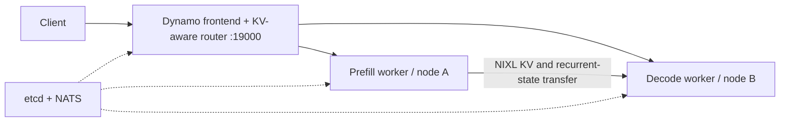

# Switchyard

Cross-node LLM serving on Stevens Jarvis, built around NVIDIA Dynamo, Slurm and vLLM, with Qwen3.6-specific Triton kernel work.

## Results

**6.6–6.7K output tokens/s at concurrency 64 on five H200s**, serving Qwen3.8-27B BF16 with cross-node prefill/decode disaggregation and DFlash2. Mean TTFT stayed around **0.9 seconds**, with observed p99 around **3 seconds**.

| Decode workload | Output tokens/s | Mean / p99 TTFT | Mean TPOT |
| --- | ---: | ---: | ---: |
| concurrency 64 · two runs | **6,567–6,741** | 0.89–0.90 / 2.99–3.06 s | 5.91–6.21 ms |
| concurrency 32 · one run | **4,937** | 0.60 / 1.63 s | **4.64 ms** |

I added the result for concurrency=32 measurements as well to observe lower latency for sacrificing some throughput. 

Separately, custom Triton reduced dense-MLP operator latency by **8.1–9.4%** versus public matmul + activation on H200. See [serving results and methodology](RESULTS.md) and [kernel implementation and measurements](kernels/README.md).

## Maybe Kubernetes?

I've been thinking about moving Switchyard to Kubernetes at some point. I wanted to experiment with NVSentinel and Node Problem Detector for GPU/node health monitoring, to potentially implement auto remediation and autoregressive fallback, and maybe Dynamo Planner for dynamically adjusting P/D ratios.

I'm not entirely sure how I'd make Kubernetes work with Stevens' Slurm cluster yet though. One idea is to run Kubernetes on my own server and connect it to Slurm if Slurm/Stevens exposes an API for it.

I'm also a bit hesitant because this would make the project a lot bigger than I originally intended. I've already spent way too much time on it this week at the expense of other commitments, and I have other todos I had in mind.

Still, I'll probably need to learn how to deploy LLMs on Kubernetes eventually anyway, so I might give it a shot. Maybe after finals or after I get the internship

## Architecture



The default model is Qwen3.6-27B; Qwen3.6-35B-A3B is selectable. Recipes enable MTP, prefix caching, and tool-call parsing. The Dynamo frontend serves OpenAI-compatible requests and SSE streaming directly. The current smoke benchmark exercises completions, not agent task success.

## Deployment

- Dynamo routes requests to vLLM prefill and decode workers; NIXL transfers KV and recurrent state across nodes.
- Recipes use existing Slurm allocations and support multiple jobs on one node. CPU/NUMA placement is selected after allocation.
- Qwen3.6-27B is the default; use `--model moe` for Qwen3.6-35B-A3B.
- MTP or DFlash2 speculation, prefix caching, tool parsing, and guarded Triton kernels are configurable in `config.yaml`.

## Run on Jarvis

Update model paths, modules, nodes, and active job IDs in `config.yaml`. The CLI environment is separate from the inference venv at `~/.venvs/vllm`.

```bash
uv sync
uv run switchyard config --list
uv run switchyard plan initial-h100
uv run switchyard preflight initial-h100
uv run switchyard bootstrap
uv run switchyard run initial-h100
```

`bootstrap` installs pinned etcd/NATS binaries. `control-check` validates the control plane without loading a model. `run` starts workers, waits for model discovery, serving directly through Dynamo on port 19000. Stop with Ctrl-C; the launcher cleans up its own services and preserves the allocations. Run directories contain the configuration snapshot and logs.

Replace expired job IDs before running. `switchyard topology <recipe>` reports GPU, NUMA, and HCA locality. See [DESIGN.md](DESIGN.md) for allocation and fabric details.

## Configure the endpoint

```yaml
frontend:
  port: 19000
  router_mode: kv
```

Update `recipes.initial-h100.allocations` with current job IDs and set the control/prefill/decode nodes to match. Model paths and the existing inference venv are under `models` and `software`. MTP=3, prefix caching, tool parsing, and kernel selection stay configured as above.

Control services and both P/D workers may share one node and Slurm allocation. For colocated workers, set disjoint `gpu_ids` lists; indices select from the `CUDA_VISIBLE_DEVICES` list Slurm exposes to that allocation step. The worker process then sees only its selected devices.

For tensor parallel workers, provide one index per GPU in `tp`. The launcher keeps etcd, NATS, and the frontend on CPU-only Slurm steps.

## Repository

- [`config.yaml`](config.yaml): model, runtime, and Jarvis recipes.
- [`src/switchyard/`](src/switchyard/): CLI and serving launcher.
- [`kernels/`](kernels/README.md): Triton operators and vLLM adapters.
- [`RESULTS.md`](RESULTS.md): serving measurements and caveats.

## Special Thanks

- [Doubleword AI](https://github.com/doublewordai) for:
  - [“When to Disaggregate”](https://blog.doubleword.ai/when-to-disaggregate)
  - [Inference Lab](https://github.com/doublewordai/inference-lab)
- [DeepFusionKernel authors](https://aclanthology.org/2026.acl-short.15/)
