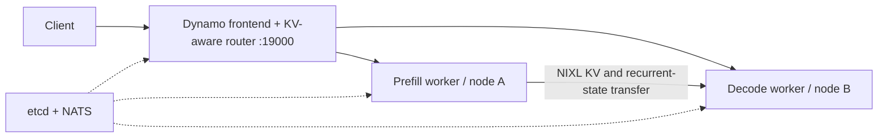

# Switchyard

Cross-node LLM serving on Stevens Jarvis: Slurm-aware NVIDIA Dynamo/vLLM recipes, and **Triton kernels** for Qwen3.6.

**Provisional result (2026-10-21):** Qwen3.6-27B BF16 reached **755 output tokens/s**, **8.56 ms mean TPOT**, and **516 ms mean TTFT** in a short decode-heavy run. Two H100 NVL GPUs performed inference: one prefill worker and one decode worker on different nodes. A third allocation hosted control services. MTP used three speculative tokens.

This is a serving-stack result; the custom kernels’ incremental contribution has not yet been measured in this deployment. See [benchmark conditions](RESULTS.md) and [Triton features and their measured contributions](kernels/README.md).

## Architecture



The default model is Qwen3.6-27B; Qwen3.6-35B-A3B is selectable. Recipes enable MTP, prefix caching, and tool-call parsing. The Dynamo frontend serves OpenAI-compatible requests and SSE streaming directly. The current smoke benchmark exercises completions, not agent task success.

Worker placement comes from existing user-owned Slurm allocations. H100/H200 placement is configurable; heterogeneous performance and the best prefill/decode ratio have not yet been measured with this deployment. [Design notes](DESIGN.md) describe ownership, transport, and fabric budgeting.

## Run on Jarvis

The inference environment is separate from this repository's small CPU tooling environment. The validated runtime is Dynamo 1.5.0, vLLM 0.28.0, and NIXL 1.3.2 in `~/.venvs/vllm`, with the modules and local checkpoints specified in `config.yaml`.

```bash
uv sync
# Edit config.yaml: model paths, modules, node placement, and current salloc job IDs.
uv run python scripts/bootstrap.py
bash scripts/serve.sh plan initial-h100
bash scripts/serve.sh preflight initial-h100
bash scripts/serve.sh control-check initial-h100
bash scripts/serve.sh run initial-h100
# Optional model: append --model moe to the commands above.
```

`bootstrap.py` installs pinned etcd/NATS binaries; it does not install the GPU runtime. `control-check` validates the control plane without loading a model. `run` starts workers, waits for model discovery, serving directly through Dynamo on port 19000. Stop with Ctrl-C; the launcher cleans up its own services and preserves the allocations. Run directories contain the configuration snapshot and logs.

To reproduce the short smoke workload, run inside a Slurm allocation after startup:

```bash
bash scripts/benchmark.sh initial-h100 http://g001:19000 runs/my-bench cross-node
```

Replace the historical allocation IDs before running. Set `engine.kernels: custom` to enable the adapters or `baseline` to disable them. Keep other settings matched for comparisons.

## Configure the endpoint

```yaml
frontend:
  port: 19000
  router_mode: kv
```

Update `recipes.initial-h100.allocations` with current job IDs and set the control/prefill/decode nodes to match. Model paths and the existing inference venv are under `models` and `software`. MTP=3, prefix caching, tool parsing, and kernel selection stay configured as above. Planner is not launched; replica counts come from the placement recipe.

Control services and both P/D workers may share one node and Slurm allocation. For colocated workers, set disjoint `gpu_ids` lists; indices select from the `CUDA_VISIBLE_DEVICES` list Slurm exposes to that allocation step. The worker process then sees only its selected devices. The `initial-h200` recipe currently places control, prefill, and decode on `g212` in allocation `1210692`, assigning prefill GPU 0 and decode GPU 1. Refresh the job ID when that allocation expires.

For tensor parallel workers, provide one index per GPU in `tp`. The launcher keeps etcd, NATS, and the frontend on CPU-only Slurm steps.

To check streaming after startup:

```bash
curl -N http://g001:19000/v1/chat/completions \
  -H 'Content-Type: application/json' \
  -d '{"model":"qwen3.6-27b","messages":[{"role":"user","content":"Hello"}],"max_tokens":64,"stream":true}'
```

Dynamo does not expose the vLLM `/tokenize` helper. Benchmark input lengths remain nominal; use the actual token counts in saved results.

## Repository

- `config.yaml`: runtime pins, model selection, engine settings, placement recipes.
- `scripts/`: launch, inventory, fabric-budget, and benchmark tools.
- `recipes/`: Jarvis module/runtime setup.
- [`kernels/`](kernels/README.md): model-specific Triton kernels and guarded vLLM integration, starting from DeepFusionKernel's published fusion ideas.
- [`RESULTS.md`](RESULTS.md): provisional measurements and historical results; [`DESIGN.md`](DESIGN.md): concise deployment notes.

Next: validate the batch 2–16 dense kernel in matched serving runs with output checks, measure effective cross-node transfer bandwidth, then tune heterogeneous placement. The separate policy-repair agent benchmark is not included here.

## Special Thanks

- [Doubleword AI](https://github.com/doublewordai) for:
  - [“When to Disaggregate”](https://blog.doubleword.ai/when-to-disaggregate)
  - [Inference Lab](https://github.com/doublewordai/inference-lab)
- [DeepFusionKernel authors](https://aclanthology.org/2026.acl-short.15/)
