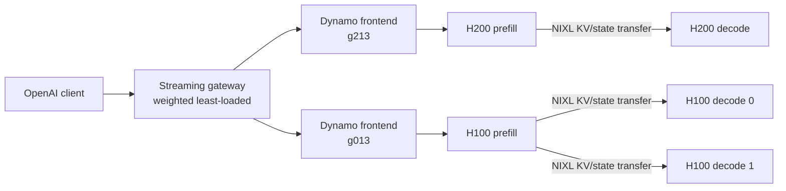

# Switchyard: heterogeneous LLM inference gateway prototype

> A reproducible Slurm prototype for heterogeneous LLM serving: local prefill/decode deployments on H200 and H100 GPUs behind one streaming OpenAI-compatible endpoint.

Switchyard was built and evaluated on Stevens HPC Jarvis. It serves **Qwen3.6-27B** on two different NVIDIA systems and pools them behind one endpoint:

- `g213`: 1 prefill + 1 decode worker on 2 × H200 NVL
- `g013`: 1 prefill + 2 decode workers on 3 × H100 SXM
- NVIDIA Dynamo handles each node's frontend and P/D routing
- a 120-line streaming gateway balances requests across the two deployments

The experiment records direct H200, direct H100, and heterogeneous-pool results using the same benchmark requests. H100 has hardware-specific context and sequence limits, recorded in [`DESIGN.md`](DESIGN.md). It is intentionally a prototype: the useful result is a measured comparison and a traceable run, not a claim that a small proxy replaces Dynamo's distributed control plane.

## Latest measured run

The 2026-09-28 run completed all 108 benchmark requests with zero request failures. It verified completion traffic on both deployments and recorded direct H200, direct H100, and pooled results in [`RESULTS.md`](RESULTS.md). The pooled prefill workload reused a deterministic prompt seed after the direct tests, so its prefix cache was warm; the report does not present that latency as a cold-cache speedup.

## Architecture



P/D stays within each node. The heterogeneous layer pools complete Dynamo deployments, so no cross-node KV transfer or distributed discovery service is required yet. This keeps the experiment reproducible on two independent Slurm allocations.

## What is measured

The unattended run executes the same two workloads against all three targets:

| Workload | Input | Output | Concurrency | Requests | Primary signal |
| --- | ---: | ---: | ---: | ---: | --- |
| Prefill heavy | 8,192 tokens | 256 tokens | 4 | 12 | TTFT and prompt throughput |
| Decode heavy | 512 tokens | 2,048 tokens | 8 | 24 | TPOT, ITL, and output throughput |

`vllm bench serve` writes detailed JSON with mean, median, and p99 TTFT, TPOT, ITL, end-to-end latency, token throughput, and failures. The gateway also records requests, active requests, and failures per hardware backend.

The longest benchmark request is 8,448 tokens. It is below the H100 98,304-token context limit and 128-sequence limit.

## Run it

Requirements are the working cluster stack used for this experiment: `ai-dynamo==1.5.0`, `vllm==0.28.0`, `nixl==1.3.2`, CUDA 13, the model at `~/models/qwen3.6-27b`, and active allocations on the nodes declared in [`config.json`](config.json).

```bash
# Show and validate the hardware profiles.
python3 scripts/config.py --list
python3 scripts/config.py --check

# Launch from a login node. Existing allocations are reused; no jobs are submitted.
export H200_JOB_ID=<job-on-g213>
export H100_JOB_ID=<job-on-g013>
./scripts/experiment.sh
```

The driver uses overlapping `srun` steps, waits up to 20 minutes for both models, runs all three comparisons, saves everything under `runs/<UTC timestamp>/`, and terminates only its own child processes.

To serve one node without the cross-node gateway:

```bash
srun --jobid="$H200_JOB_ID" --overlap ./scripts/serve.sh h200-pd
srun --jobid="$H100_JOB_ID" --overlap ./scripts/serve.sh h100-1p2d
```

Hardware and model tuning remain explicit calibration knobs:

```bash
MTP_TOKENS_OVERRIDE=0 ./scripts/serve.sh h200-pd
GPU_MEMORY_UTILIZATION_OVERRIDE=0.85 ./scripts/serve.sh h100-1p2d
MODEL_PATH_OVERRIDE=/shared/models/qwen ./scripts/serve.sh h200-pd
```

## Repository map

| Path | Purpose |
| --- | --- |
| [`config.json`](config.json) | Nodes, GPU placement, ports, model, and gateway backends |
| [`scripts/serve.sh`](scripts/serve.sh) | Starts one Dynamo frontend and its local P/D workers |
| [`scripts/gateway.py`](scripts/gateway.py) | Preserves streamed responses and balances by active load/weight |
| [`scripts/benchmark.sh`](scripts/benchmark.sh) | Fixed, comparable online serving workloads |
| [`scripts/experiment.sh`](scripts/experiment.sh) | Reuses both allocations and captures one complete run |
| [`RESULTS.md`](RESULTS.md) | Measurements, interpretation, and limitations |
| [`DESIGN.md`](DESIGN.md) | Scope and engineering decisions |

## Findings that led here

The initial two-H200 P/D prototype established that Dynamo routing and NIXL state transfer worked, with 95.5–100% external prefix reuse. A forced FlashInfer decode attention backend pushed speculative decode into piecewise CUDA graphs and limited warm decode to roughly 25–28 tokens/s. Letting vLLM choose the decode backend recovered roughly 64–71 tokens/s while preserving remote reuse. [`RESULTS.md`](RESULTS.md) separates those exploratory observations from the controlled heterogeneous run.

## Scope

This prototype does not claim production availability, cost optimal routing, or cross-node heterogeneous P/D. File discovery is deliberately limited to each machine; multi-node Dynamo discovery would require etcd and NATS. The gateway policy is a visible, tunable baseline for testing whether pooled capacity helps a mixed workload.

## References

- [NVIDIA Dynamo deployment guide](https://docs.nvidia.com/dynamo/dev/cli/model-deployment/introduction)
- [Dynamo local and distributed discovery](https://docs.nvidia.com/dynamo/dev/cli/installation/install-dynamo)
- [vLLM disaggregated prefilling](https://docs.vllm.ai/en/latest/features/disagg_prefill/)
- [vLLM online serving benchmark](https://docs.vllm.ai/en/latest/cli/bench/serve.html)
