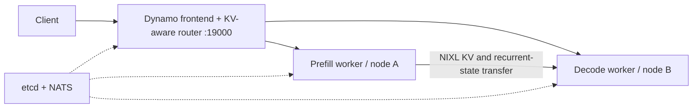

# Switchyard

Cross-node LLM serving on Stevens Jarvis, built around NVIDIA Dynamo, Slurm and vLLM, with Qwen3.6-specific Triton kernel work.

## Provisional result

A short Qwen3.6-27B BF16 run reached **755 output tokens/s**, **8.56 ms mean TPOT**, and **516 ms mean TTFT** on a decode-heavy workload. It used one H100 NVL for prefill, one for decode, MTP=3, and a separate control allocation. The prefill-heavy run reached **190.81 output tokens/s**.

These are provisional serving results. See [RESULTS.md](RESULTS.md) for the method and [kernels/README.md](kernels/README.md) for operator results and dispatch evidence.

## Architecture



The default model is Qwen3.6-27B; Qwen3.6-35B-A3B is selectable. Recipes enable MTP, prefix caching, and tool-call parsing. The Dynamo frontend serves OpenAI-compatible requests and SSE streaming directly. The current smoke benchmark exercises completions, not agent task success.

## Deployment

- Dynamo routes requests to vLLM prefill and decode workers; NIXL transfers KV and recurrent state across nodes.
- Recipes use existing Slurm allocations and support multiple jobs on one node. CPU/NUMA placement is selected after allocation.
- Qwen3.6-27B is the default; use `--model moe` for Qwen3.6-35B-A3B.
- MTP, prefix caching, tool parsing, and guarded Triton kernels are configurable in `config.yaml`.

## Run on Jarvis

Update model paths, modules, nodes, and active job IDs in `config.yaml`. The CLI environment is separate from the inference venv at `~/.venvs/vllm`.

```bash
uv sync
uv run switchyard config --list
uv run switchyard plan initial-h100
uv run switchyard preflight initial-h100
uv run switchyard bootstrap
uv run switchyard run initial-h100
```

`bootstrap.py` installs pinned etcd/NATS binaries. `control-check` validates the control plane without loading a model. `run` starts workers, waits for model discovery, serving directly through Dynamo on port 19000. Stop with Ctrl-C; the launcher cleans up its own services and preserves the allocations. Run directories contain the configuration snapshot and logs.

Replace expired job IDs before running. `switchyard topology <recipe>` reports GPU, NUMA, and HCA locality. See [DESIGN.md](DESIGN.md) for allocation and fabric details.

## Configure the endpoint

```yaml
frontend:
  port: 19000
  router_mode: kv
```

Update `recipes.initial-h100.allocations` with current job IDs and set the control/prefill/decode nodes to match. Model paths and the existing inference venv are under `models` and `software`. MTP=3, prefix caching, tool parsing, and kernel selection stay configured as above.

Control services and both P/D workers may share one node and Slurm allocation. For colocated workers, set disjoint `gpu_ids` lists; indices select from the `CUDA_VISIBLE_DEVICES` list Slurm exposes to that allocation step. The worker process then sees only its selected devices.

For tensor parallel workers, provide one index per GPU in `tp`. The launcher keeps etcd, NATS, and the frontend on CPU-only Slurm steps.

## Repository

- [`config.yaml`](config.yaml): model, runtime, and Jarvis recipes.
- [`src/switchyard/`](src/switchyard/): CLI and serving launcher.
- [`kernels/`](kernels/README.md): Triton operators and vLLM adapters.
- [`RESULTS.md`](RESULTS.md): serving measurements and caveats.

## Special Thanks

- [Doubleword AI](https://github.com/doublewordai) for:
  - [“When to Disaggregate”](https://blog.doubleword.ai/when-to-disaggregate)
  - [Inference Lab](https://github.com/doublewordai/inference-lab)
- [DeepFusionKernel authors](https://aclanthology.org/2026.acl-short.15/)
